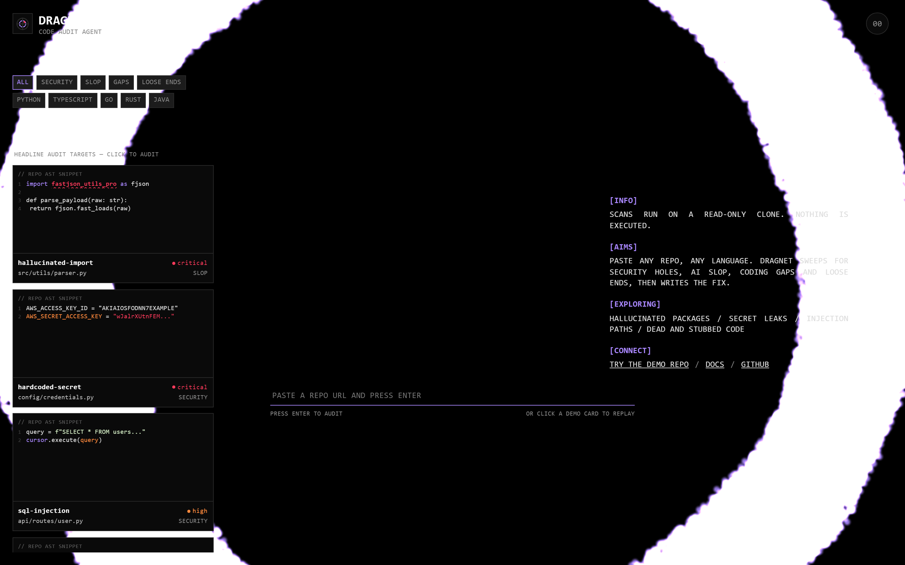
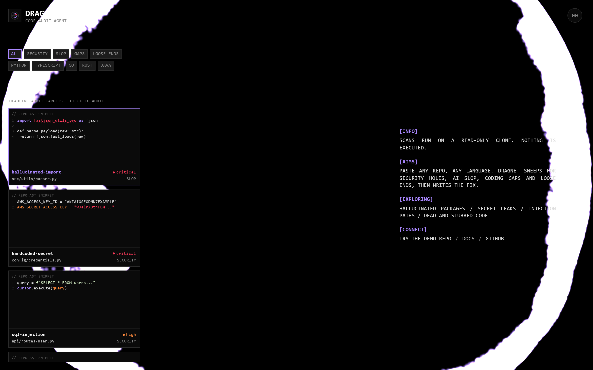

# DRAGNET — Architecture-Agnostic Code Auditor & AntiSlop Triage Agent

> An intelligent, architecture-agnostic code auditor that sweeps repositories for security vulnerabilities, AI slop (including hallucinated packages and slopsquatting risks), structural coding gaps, and loose ends — ranking findings, explaining root causes, and synthesizing ready-to-apply diff patches.

---

## Visual Tour

### 1. Landing & Command Interface
A persistent WebGL GPGPU hero particle cloud (262,144 points) with interactive cursor fluid dynamics, pre-configured headline audit cards, and instantaneous repo ingestion.



---

### 2. Live Scan Stream Console
Real-time Server-Sent Events (SSE) streaming abstract syntax tree (AST) traversal stages, language breakdowns, and staggered findings feeds with 2px severity-colored left borders.


---

### 3. Executive Dashboard & Health Score
Automated health score animation (0–100), monospace ASCII block breakdown bars (`[████████░░░░░░░░░░░░]`), hotspot density mapping, and one-click SARIF 2.1.0 / Markdown report exports.


---

### 4. Interactive Remediation Drawer & Side-by-Side Diff
Automated plain-English explanations, Slopsquatting risk detection (`"PACKAGE DOES NOT EXIST ON NPM/PYPI"`), and side-by-side git diff viewer with one-click `APPLY FIX` and `COPY PATCH` actions.



---

## Key Capabilities & Detection Engine

| Category | Targeted Failure Modes | Detection Engine |
| :--- | :--- | :--- |
| **Security** | Hardcoded AWS/Stripe API keys, SQL string concatenation, CORS wildcard credentials, unsafe deserialization | Gitleaks, Semgrep rules, AST inspection |
| **AI Slop** | Hallucinated imports (slopsquatting risk), 30+ line copy-paste function duplicates, over-commented placeholder logic | AST parsing, PyPI & npm registry check (404 verification), Token-shingle hashing |
| **Gaps** | Empty `except Exception: pass`, unhandled asynchronous promises, missing input boundary validation | Tree-sitter polyglot AST, static control flow analysis |
| **Loose Ends** | Production `TODO`/`FIXME` stubs, empty function declarations, hardcoded localhost URLs, console logging of tokens | AST regex sweep, import graph analysis |

---

## Flagship Feature: AntiSlop & Slopsquatting Detection

Large Language Models frequently hallucinate package names that sound plausible (e.g., `fastjson_utils_pro`). Because these packages do not exist on public package registries, attackers register them to execute arbitrary code on build systems and developers' laptops (slopsquatting).

Dragnet automatically:
1. Traverses all `import` statements in the repository AST.
2. Filters out known standard libraries.
3. Queries public registries (`pypi.org` and `npmjs.org`) in real time.
4. Alerts on `404 Not Found` statuses as **Critical Slopsquatting Risks** and synthesizes a safe drop-in replacement patch.

---

## Technical Architecture

```
dragnet/
├── arena.json              # Hackathon submission metadata & entrypoints
├── AI_LOG.md               # AI triage pipeline, prompt specifications & dev log
├── README.md               # System documentation & architectural overview
├── app/
│   ├── layout.tsx          # Root layout mounting persistent GPGPU particle field
│   ├── page.tsx            # Landing page with headline audit targets
│   ├── scan/[id]/page.tsx  # Live streaming scan console & dashboard
│   └── api/scan/           # SSE streaming, SARIF 2.1.0, and Markdown export endpoints
├── components/
│   ├── ParticleField.tsx   # 262,144-point GPGPU ping-pong & fluid simulation
│   ├── LandingCards.tsx    # Spacious syntax-colored preview cards
│   ├── LiveFeedCards.tsx   # Live findings stream with keyboard navigation
│   ├── FindingDrawer.tsx   # Side-by-side diff viewer with automated patch application
│   └── DashboardSummary.tsx# Monospace ASCII breakdown bars & hotspots
├── backend/                # Standalone Python FastAPI detector engine
│   ├── main.py             # FastAPI entrypoint & SSE event bus
│   ├── pipeline.py         # Multi-detector orchestrator
│   └── detectors/          # Secrets, deps (PyPI), rules, and loose ends
└── demo-repos/             # Seeded repository demonstrating real-time detections
```

---

## Mathematical & Visual Compute Highlights

* **GPGPU Ping-Pong Simulation:** 262,144 concurrent particles simulated on the GPU using dual 32-bit floating-point textures (`512 × 512`), with zero CPU compute overhead.
* **Signed Distance Fields (SDF):** Surface attraction based on analytical implicit torus geometry ($R=2.1, r=0.55$) with normal gradients computed via central differences.
* **Divergence-Free Curl Noise:** Analytical curl potentials ($\nabla \cdot (\nabla \times \mathbf{\Psi}) \equiv 0$) driving volume-preserving turbulent advection.
* **Eulerian Cursor Fluid Dynamics:** Pointer velocity impulses injected into the simulation grid; particles scatter and heal back to equilibrium within $1.5\text{–}2.0\text{ seconds}$.

---

## Quickstart & Local Execution

### Prerequisites
* Node.js 18+ (tested on v20 & v22)
* Modern browser with WebGL 2 support

### Run Fullstack Web Application
```bash
# Clone the repository
git clone https://github.com/quagmire49/dragnet.git
cd dragnet

# Install dependencies
npm install

# Run in production mode
npm run build
npm start
```
Visit **[http://localhost:3000](http://localhost:3000)** in your browser.

### Keyboard Shortcuts
* <kbd>j</kbd> / <kbd>k</kbd> — Navigate findings in feed
* <kbd>/</kbd> — Focus findings search
* <kbd>Enter</kbd> — Open finding detail drawer
* <kbd>Esc</kbd> — Close drawer / modal
* <kbd>Cmd</kbd> + <kbd>K</kbd> / <kbd>Ctrl</kbd> + <kbd>K</kbd> — Open cyber command palette

---

## License

Released under the MIT License. Developed for the Mycrobo Hackathon — AntiSlop / AI Triage Track.
