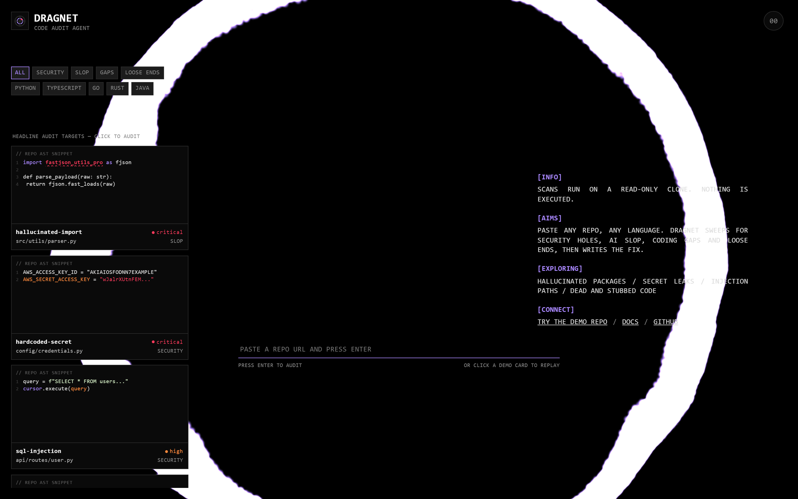
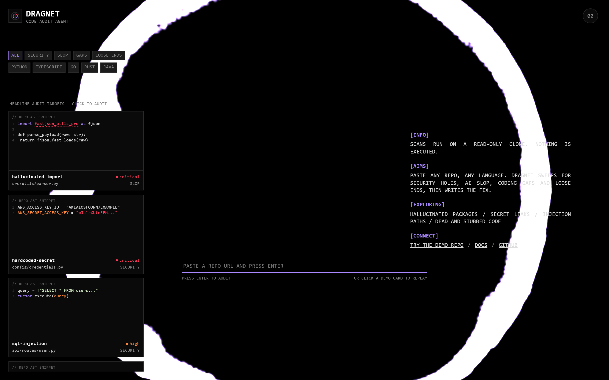

# DRAGNET — Architecture-Agnostic Code Auditor Agent

> Pure black (#000), fixed WebGL GPGPU hero particle cloud, real-time code auditing for security holes, AI slop, structural gaps, and loose ends.


---

## 01. Visual & Technical Architecture (AXON Specification)

Dragnet re-skins the high-fidelity **AXON motion research hub** visual spec into a cyber-ops command center code auditor:

- **Global Viewport:** Pure black page (`#000`), zero page scroll (`overflow: hidden`), full-viewport fixed `canvas#bg` (WebGL), and fixed `.ui` layer with `pointer-events: none` (re-enabled on interactive elements).
- **Typography:** Pure system monospace stack only: `"SF Mono", Menlo, Consolas, "Liberation Mono", monospace`. 13px, uppercase, line-height 1.35, letter-spacing `.02em`.
- **Text Blending:** Mix-blend-mode `plus-lighter` for terminal text blocks; opaque `#0a0a0a` panels for code diffs and cards.
- **Design Tokens:**
  - `--accent`: `#aa88ff` (headings, active highlight)
  - `--text`: `#dddddd`
  - `--muted`: `#8a8a8a`
  - `--chip`: `#1c1c1c`
  - `--line`: `#2a2a2a`
  - **Severity Colors (Particles & 2px Card Left Edges Only):**
    - `critical`: `#FF3B5C`
    - `high`: `#FF8A3D`
    - `medium`: `#FFD23D`
    - `low`: `#3DA9FF`

---

## 02. Hero Particle Cloud (Section 7 & 8)

Mounted once in the root layout (`<ParticleField />`), persisting across route transitions with zero re-init or flash:

1. **GPGPU Ping-Pong Simulation:**
   - **262,144 points** (512x512 float texture) on desktop; **16,384 points** (128x128) on mobile or when `prefers-reduced-motion` is active.
   - Dual WebGL render targets ping-ponging velocities and positions.
   - **3D Torus / Ring SDF Attraction:** Restorative spring pull towards the ring surface ($R=2.1, r=0.55$).
   - **3D Curl Noise Advection:** Simplex noise gradient curl generating laminar turbulence.
2. **GPU Fluid Sim & Cursor Splats:**
   - Unprojects pointer coordinates onto the 3D plane; moving the mouse creates velocity splats and stir impulses.
   - Particles scatter and heal back into the toroidal ring within ~2.0 seconds.
3. **Additive Matcap Sprites:**
   - Embedded 64x64 soft-sphere radial matcap data URI.
   - Additive blending (`THREE.AdditiveBlending`), lavender sparks (`#aa88ff`).
4. **Dragnet State Progression:**
   - **Idle (Landing):** Ethereal lavender cloud rotating gently; cursor stirs the fluid.
   - **Scanning:** Ring rotation accelerates (2.4x) and curl noise ramps up (0.85). Each incoming finding flashes particles in that finding's severity color. Critical and high severity findings maintain permanent tinted floor pixels.
   - **Done:** Particle cloud settles; category mix reflected in particle tints.
   - **Ring Flash:** Detection or selection of a `hallucinated-import` triggers a one-time lavender-white ring pulse!
5. **Fallback:** If WebGL or float textures are unavailable, gracefully falls back to a static CSS radial-dot background.

---

## 03. Core Screens

### Screen 1: Landing (`/`)
- Brand top-left (40x40 SVG mark, `DRAGNET` 20px white, `Code audit agent` 11px muted).
- Round 44x44 counter top-right showing `"00"` (idle).
- Tag chips row (left, top 120, width 320): `ALL`, `SECURITY`, `SLOP`, `GAPS`, `LOOSE ENDS`, `PYTHON`, `TYPESCRIPT`, `GO`, `RUST`, `JAVA`.
- Left list (top 240): Scrollable cards with 160px syntax-colored code thumbs and `.meta` pairs.
- Right text column: `[info]`, `[aims]`, `[exploring]`, `[connect]`.
- Centered repo URL input: Borderless mono input with accent underline and blinking caret; pressing Enter triggers a 700ms camera dolly-in transition into the audit.

### Screen 2: Live Scan (`/scan/[id]`)

- Terminal log streaming SSE `stage` and `log` events with `[OK]` and `[WARN]` indicators.
- Live findings feed animating in with staggered opacity + 8px translateY entrances and 2px severity-colored left edges.
- 44x44 top-right counter increments live findings.

### Screen 3: Dashboard (`/scan/[id]` state `done`)

- 44x44 top-right counter counts up to Health Score (38/100 over 1.2s), shifting color from `#FF3B5C` to `#aa88ff` to `#fff`.
- Right column scan summary:
  - `[health]` Score + one-sentence verdict.
  - `[breakdown]` Monospace 20-character ASCII block bars (`[████████░░░░░░░░░░░░]`).
  - `[hotspots]` Top 5 files by finding density (clickable to filter findings feed).
  - `[export]` Download Markdown report, SARIF 2.1.0, or start a new scan.
- Full keyboard shortcuts: `j`/`k` navigation, `/` search, `Enter` opens drawer, `Esc` closes.
- `Cmd+K` / `Ctrl+K` cyber command palette.

### Screen 4: Finding Detail Drawer

- Slides in from right (320ms ease-out) over the text column.
- Offending code snippet with `#aa88ff` left rule and line numbers.
- `[why this matters]` Plain-English impact explanation.
- Side-by-side git diff powered by `react-diff-viewer-continued` (black background, added `#cfe8c0` on `#0f1a0b`, removed `#ffb3bf` on `#1a0b0f`).
- Slopsquatting alert for hallucinated packages: `"PACKAGE DOES NOT EXIST ON NPM/PYPI. SLOPSQUATTING RISK."` with lavender ring pulse.
- `APPLY FIX`, `COPY PATCH`, and `CLOSE` action chips.

---

## 04. Quickstart

### Prerequisites
- Node.js 18+ (tested on v22)
- Python 3.10+ (for backend API)

### 1. Install & Run Next.js Fullstack Web App
```bash
npm install
npm run build
npm start
```
Open [http://localhost:3000](http://localhost:3000) in your browser.

### 2. Run Optional FastAPI Backend
```bash
pip install fastapi uvicorn pydantic httpx
python -m backend.main
```
FastAPI runs on `http://localhost:8000`.

---

## 05. Acceptance Screenshots
All screenshots verified in Chromium and saved in `docs/screenshots/`:
- `landing.png`
- `scanning.png`
- `dashboard.png`
- `drawer.png`
